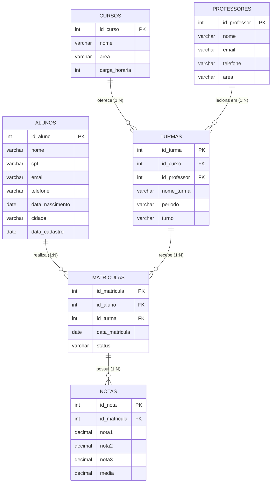

# Apostila Completa: Bancos de Dados e SQL (Módulo 09 - ITEAM 2026)

**Curso:** Capacitação em Desenvolvimento Full Stack — ITEAM (Boa Vista/RR)  
**Disciplina:** Módulo 09: Bancos de Dados e SQL (32 horas)  
**Professor:** Janei Vieira Pereira  

---

## Sumário

1. [Unidade 1: Fundamentos de Bancos de Dados e SGBDs](#unidade-1-fundamentos-de-bancos-de-dados-e-sgbds)
2. [Unidade 2: Arquitetura de SGBD e Modelagem Conceitual](#unidade-2-arquitetura-de-sgbd-e-modelagem-conceitual)
3. [Unidade 3: Chaves, Normalização e Diagrama Entidade-Relacionamento (DER)](#unidade-3-chaves-normalização-e-diagrama-entidade-relacionamento-der)
4. [Unidade 4: Linguagem SQL — Definição de Estruturas (DDL)](#unidade-4-linguagem-sql--definição-de-estruturas-ddl)
5. [Unidade 5: Linguagem SQL — Manipulação e Filtragem (DML, WHERE, ORDER BY)](#unidade-5-linguagem-sql--manipulação-e-filtragem-dml-where-order-by)
6. [Unidade 6: Funções Agregadas, Agrupamento (`GROUP BY`) e `HAVING`](#unidade-6-funções-agregadas-agrupamento-group-by-e-having)
7. [Unidade 7: Consultas Multi-Tabelas (`JOINs`) e Subconsultas](#unidade-7-consultas-multi-tabelas-joins-e-subconsultas)
8. [Unidade 8: Recursos Avançados (`Views`, `Índices`, `Transações`, `Procedures` e `Triggers`)](#unidade-8-recursos-avançados-views-índices-transações-procedures-e-triggers)
9. [Referências Bibliográficas](#referências-bibliográficas)

---

## Unidade 1: Fundamentos de Bancos de Dados e SGBDs

### 1.1. Dados, Informação e Conhecimento
No desenvolvimento de sistemas, distinguir **dado** e **informação** orienta toda a arquitetura de persistência:

* **Dado:** Registro bruto e isolado de um fato, sem contexto suficiente para tomada de decisão. Exemplos: `'Maria Silva'`, `9.5`, `'2026-10-30'`, `'Boa Vista'`.
* **Informação:** Resultado do processamento, organização e contextualização dos dados. Exemplo: *"A aluna Maria Silva, de Boa Vista, obteve média 9,5 na turma de Banco de Dados em 30/10/2026"*.
* **Conhecimento:** Interpretação analítica da informação acumulada para orientar decisões estratégicas. Exemplo: *"As turmas do turno noturno em Boa Vista apresentam taxa de aprovação 18% superior quando utilizam laboratórios guiados em SQL"*.

```text
+-------------------+       Processamento /       +-----------------------+       Análise e       +--------------------+
|    DADO BRUTO     |  --->   Contextualização    |      INFORMAÇÃO       |  --->   Experiência   |    CONHECIMENTO    |
| "9.5", "Turma A"  |                             | "Média da Turma A:    |                       | "Ação pedagógica   |
|                   |                             |  9,5 no semestre"     |                       |  para o semestre"  |
+-------------------+                             +-----------------------+                       +--------------------+
```

### 1.2. O que é um Banco de Dados vs. SGBD
* **Banco de Dados (BD):** Coleção organizada de dados logicamente relacionados, projetada para representar informações de um domínio específico (como uma escola, um hospital ou um e-commerce).
* **SGBD (Sistema Gerenciador de Banco de Dados):** Conjunto de programas (software) que gerencia o armazenamento físico, a segurança, a integridade, o controle de concorrência (múltiplos acessos simultâneos) e a recuperação a falhas (backup/recovery).

### 1.3. Evolução Histórica do Armazenamento de Dados
Antes dos bancos relacionais modernos, o armazenamento de dados passou por quatro gerações principais:

| Época | Modelo | Características Principais | Limitações |
| :--- | :--- | :--- | :--- |
| **Anos 1950–1960** | **Arquivos Planos (Flat Files)** | Dados gravados em arquivos sequenciais de texto (`.txt`, `.csv`) ou fitas magnéticas. Cada programa conhecia a posição física exata dos campos. | Alta redundância, inconsistência, ausência de controle de acesso simultâneo e forte acoplamento entre código e arquivo. |
| **Anos 1960** | **Modelo Hierárquico** | Organização em estrutura de árvore (pai-filho, `1:N`), como o IBM IMS usado no programa Apollo. | Rigidez estrutural: difícil representar relações `N:N` sem duplicar registros inteiros. |
| **Fim dos Anos 1960** | **Modelo em Rede (CODASYL)** | Evolução da árvore para grafos com ponteiros físicos, permitindo que um registro filho tivesse múltiplos pais (`N:N`). | Consultas dependiam de navegação complexa por ponteiros físicos em disco. |
| **1970 até hoje** | **Modelo Relacional (E. F. Codd)** | Dados organizados em **relações (tabelas)** bidimensionais compostas por linhas (tuplas) e colunas (atributos), baseadas na teoria dos conjuntos e lógica de predicados. | Exige modelagem prévia e cuidado com junções pesadas em volumes massivos sem indexação. |
| **Anos 2000+** | **NoSQL e NewSQL** | Modelos orientados a documentos (MongoDB), chave-valor (Redis), colunares (Cassandra) e grafos (Neo4j). | Menor padronização de linguagem de consulta e, em muitos casos, consistência eventual em vez de ACID imediato. |

### 1.4. Comparativo: Bancos Relacionais (SQL) vs. Não Relacionais (NoSQL)

| Critério | Banco Relacional (SQL) | Banco Não Relacional (NoSQL) |
| :--- | :--- | :--- |
| **Unidade de Armazenamento** | Tabelas com linhas (tuplas) e colunas (atributos) | Documentos JSON/BSON, pares Chave-Valor, Colunas ou Grafos |
| **Esquema (Schema)** | Rígido e pré-definido via DDL | Flexível / Dinâmico (Schema-less ou Schema-on-read) |
| **Garantia Transacional** | **ACID** (Atomicidade, Consistência, Isolamento, Durabilidade) | Geralmente **BASE** (Disponibilidade básica e consistência eventual), com suporte ACID em versões modernas |
| **Escalabilidade Padrão** | Vertical (Scale-up: mais CPU/RAM no servidor) e réplicas de leitura | Horizontal (Scale-out: particionamento/sharding nativo em clusters) |
| **Exemplos de Mercado** | MySQL, PostgreSQL, Oracle, SQL Server, MariaDB, SQLite | MongoDB, Redis, Cassandra, DynamoDB, Neo4j |
| **Casos de Uso Ideais** | Sistemas acadêmicos (`escola_db`), ERPs, sistemas bancários, faturamento | Catálogos variáveis, cache de sessão, telemetria IoT, feeds sociais |

---

## Unidade 2: Arquitetura de SGBD e Modelagem Conceitual

### 2.1. Arquitetura Interna de um SGBD
Quando uma aplicação ou o cliente DBeaver envia um comando SQL ao servidor, o SGBD executa uma cadeia bem definida de componentes internos:

```text
[ Aplicação / DBeaver ]
          |
          v  (Envia comando SQL)
+-------------------------------------------------------------------+
|                        SERVIDOR SGBD                              |
|                                                                   |
|  1. Gerenciador de Conexões e Segurança (Autenticação/Permissões) |
|          |                                                        |
|          v                                                        |
|  2. Processador de Consultas                                      |
|     ├── Parser (Análise sintática e semântica do SQL)             |
|     ├── Otimizador (Escolhe o melhor plano de execução e índices) |
|     └── Executor (Executa o plano escolhido)                      |
|          |                                                        |
|          v                                                        |
|  3. Gerenciador de Transações e Concorrência (Locks / Logs ACID)  |
|          |                                                        |
|          v                                                        |
|  4. Gerenciador de Armazenamento e Buffer Pool (Memória RAM)      |
+-------------------------------------------------------------------+
          |
          v  (Leitura / Escrita em blocos)
[ Disco Físico: Arquivos de Dados, Índices e Redo/Undo Logs ]
```

### 2.2. Principais SGBDs Relacionais do Mercado
1. **MySQL / MariaDB:** Muito adotado em aplicações web e cursos Full Stack pela leveza, rapidez de leitura e facilidade de operação. É o SGBD padrão utilizado na base `escola_db` deste módulo.
2. **PostgreSQL:** SGBD open-source objeto-relacional reconhecido pela conformidade estrita com o padrão ANSI SQL, suporte avançado a JSONB, extensões geoespaciais (PostGIS) e otimizador robusto.
3. **Oracle Database:** Solução corporativa amplamente empregada em grandes bancos, telecomunicações e órgãos governamentais, com linguagem procedural PL/SQL.
4. **Microsoft SQL Server:** Forte integração com o ecossistema `.NET`, Azure e ferramentas de Business Intelligence (Power BI), utilizando a linguagem T-SQL.
5. **SQLite:** Banco relacional embarcado em um único arquivo local, sem processo servidor separado, muito usado em dispositivos móveis (Android/iOS) e testes locais.

### 2.3. Conceitos do Modelo Conceitual: Entidades, Atributos e Relacionamentos

#### Entidades
Representam objetos do mundo real (concretos ou abstratos) sobre os quais desejamos manter dados. No sistema acadêmico `escola_db`, são entidades: **`Aluno`**, **`Professor`**, **`Curso`**, **`Turma`**, **`Matrícula`** e **`Nota`**.

#### Atributos
São as propriedades ou características que descrevem uma entidade:
* **Atributo Simples (Atômico):** Não pode ser subdividido (ex.: `cpf`, `turno`, `carga_horaria`).
* **Atributo Composto:** Pode ser dividido em partes menores com significado próprio (ex.: `endereco` dividido em `logradouro`, `numero`, `bairro`, `cidade`, `uf`).
* **Atributo Multivalorado:** Pode assumir mais de um valor para a mesma entidade (ex.: `telefones` de um aluno).
* **Atributo Derivado:** Seu valor pode ser calculado a partir de outros atributos (ex.: `idade`, calculada a partir de `data_nascimento`; ou `media`, calculada a partir de `nota1`, `nota2` e `nota3`).
* **Atributo Identificador (Chave):** Identifica exclusivamente cada ocorrência da entidade (ex.: `id_aluno`).

#### Relacionamentos e Cardinalidades
Associação lógica entre duas ou mais entidades. A **cardinalidade** define quantas ocorrências de uma entidade podem se associar a ocorrências de outra:

1. **Um para Um (`1:1`):**
   * *Exemplo:* Um **Curso** possui um único **Coordenador Exclusivo**, e cada coordenador dirige apenas um curso.
2. **Um para Muitos (`1:N`):**
   * *Exemplo:* Um **Curso** oferece várias **Turmas** (`1:N`), mas cada **Turma** pertence a um único **Curso**.
   * *Regra de implementação:* A chave primária do lado `1` (`id_curso`) migra como chave estrangeira (`FOREIGN KEY`) para a tabela do lado `N` (`turmas`).
3. **Muitos para Muitos (`N:N`):**
   * *Exemplo:* Um **Aluno** pode se matricular em várias **Turmas**, e uma **Turma** possui vários **Alunos** matriculados.
   * *Regra de implementação:* O modelo relacional físico não liga duas tabelas diretamente em `N:N`. Cria-se uma **tabela associativa** (no `escola_db`, a tabela `matriculas`) contendo chaves estrangeiras para `alunos` (`id_aluno`) e para `turmas` (`id_turma`).

---

## Unidade 3: Chaves, Normalização e Diagrama Entidade-Relacionamento (DER)

### 3.1. Chaves no Modelo Relacional
* **Superchave:** Qualquer conjunto de um ou mais atributos que identifica unicamente uma linha.
* **Chave Candidata:** Mínima superchave sem atributos supérfluos (ex.: `id_aluno` ou `cpf`).
* **Chave Primária (`PRIMARY KEY` - PK):** Chave candidata escolhida pelo projetista para identificar oficialmente cada registro da tabela. Nunca pode ser nula (`NOT NULL`) e nunca se repete (`UNIQUE`).
* **Chave Estrangeira (`FOREIGN KEY` - FK):** Coluna (ou conjunto de colunas) em uma tabela filha que referencia a `PRIMARY KEY` de uma tabela pai, estabelecendo o vínculo lógico entre elas.
* **Chave Composta:** Chave primária formada pela combinação de duas ou mais colunas (ex.: `(id_emprestimo, id_livro)` em `itens_emprestimo`).

### 3.2. Integridade Referencial
A integridade referencial garante que um valor de chave estrangeira sempre aponte para um registro válido existente na tabela referenciada. Graças a ela, o SGBD:
1. **Impede matrículas órfãs:** Não permite inserir em `matriculas` um `id_aluno = 999` se o aluno `999` não existir na tabela `alunos`.
2. **Protege contra exclusões acidentais (`ON DELETE RESTRICT`):** Impede apagar um curso na tabela `cursos` caso existam turmas vinculadas a ele em `turmas`.

### 3.3. Normalização de Dados (1FN, 2FN e 3FN)
A normalização é o processo sistemático proposto por Edgar F. Codd para eliminar redundâncias e anomalias de inserção, atualização e exclusão.

#### Exemplo Prático da Apostila: Planilha Acadêmica Não Normalizada (0FN)
Imagine uma planilha única controlada manualmente pela secretaria:

| id_aluno | nome_aluno | telefones | id_curso | nome_curso | prof_curso | email_prof | nota_final |
| :---: | :--- | :--- | :---: | :--- | :--- | :--- | :---: |
| 101 | Ana Souza | 95-99111-0001, 95-3623-1000 | 10, 20 | SQL, Node.js | Carlos, Marcos | carlos@iteam.br, marcos@iteam.br | 9.0, 8.5 |

#### Primeira Forma Normal (1FN): Atomicidade e Fim de Grupos Repetitivos
> **Regra da 1FN:** Todos os atributos devem conter apenas valores **atômicos (indivisíveis)** e não podem existir listas ou grupos repetitivos na mesma célula.

* **Aplicação:** Separamos os telefones em uma tabela `aluno_telefones` e desmembramos cada matrícula de curso em sua própria linha na tabela `matriculas_cursos(id_aluno, id_curso, nome_aluno, nome_curso, prof_curso, email_prof, nota_final)`.

#### Segunda Forma Normal (2FN): Dependência Funcional Total da Chave Primária
> **Regra da 2FN:** A tabela deve estar na 1FN e todo atributo não-chave deve depender **da chave primária inteira**, e não apenas de parte dela (aplica-se a tabelas com chave primária composta).

* **Problema encontrado na 1FN:** Na tabela cuja chave composta é `(id_aluno, id_curso)`, o atributo `nome_aluno` depende apenas de `id_aluno`, enquanto `nome_curso` e `prof_curso` dependem apenas de `id_curso`. Apenas `nota_final` depende do par `(id_aluno, id_curso)`.
* **Aplicação:** Criamos três tabelas:
  1. `alunos (id_aluno PK, nome_aluno)`
  2. `cursos (id_curso PK, nome_curso, prof_curso, email_prof)`
  3. `matriculas (id_aluno FK, id_curso FK, nota_final, PRIMARY KEY(id_aluno, id_curso))`

#### Terceira Forma Normal (3FN): Eliminação de Dependências Transitivas
> **Regra da 3FN:** A tabela deve estar na 2FN e nenhum atributo não-chave pode depender de outro atributo não-chave (dependência transitiva).

* **Problema encontrado na 2FN:** Na tabela `cursos (id_curso PK, nome_curso, prof_curso, email_prof)`, o atributo `email_prof` depende do professor (`prof_curso`), e não do curso em si. Se o professor trocar de e-mail, teríamos de atualizar várias linhas de cursos diferentes.
* **Aplicação:** Extraímos os dados do professor para uma tabela própria `professores`:
  1. `professores (id_professor PK, nome_professor, email_prof)`
  2. `cursos (id_curso PK, nome_curso, id_professor FK)`

### 3.4. Diagrama Entidade-Relacionamento (DER) e Notações
Durante o curso trabalhamos com três representações visuais principais em ferramentas como **Draw.io (diagrams.net)**, **BRModelo** e **dbdiagram.io**:

1. **Notação de Peter Chen (Conceitual):**
   * Retângulos representam **Entidades**.
   * Losangos representam **Relacionamentos**.
   * Elipses representam **Atributos** (elipse preenchida ou sublinhada indica chave primária).
2. **Notação Pé de Galinha / Crow's Foot (Lógica/Relacional):**
   * Tabelas são caixas com a lista de colunas tipadas (`PK` e `FK`).
   * Linhas conectam as tabelas usando símbolos nas extremidades:
     * `||` : Exatamente um (`1` obrigatório)
     * `o|` : Zero ou um (`0..1` opcional)
     * `|<` : Um ou muitos (`1..N`)
     * `o<` : Zero ou muitos (`0..N`)

#### DER do Banco Oficial `escola_db` (Mermaid Crow's Foot)


---

## Unidade 4: Linguagem SQL — Definição de Estruturas (DDL)

### 4.1. Subconjuntos da Linguagem SQL
A linguagem SQL (Structured Query Language) é dividida em subconjuntos funcionais:

* **DDL (Data Definition Language):** Define e altera a estrutura dos objetos (`CREATE`, `ALTER`, `DROP`, `TRUNCATE`).
* **DML (Data Manipulation Language):** Manipula os registros dentro das tabelas (`INSERT`, `UPDATE`, `DELETE`).
* **DQL (Data Query Language):** Consulta e recupera dados (`SELECT`, muitas vezes agrupado didaticamente junto à DML).
* **DCL (Data Control Language):** Controla permissões de acesso (`GRANT`, `REVOKE`).
* **TCL (Transaction Control Language):** Gerencia transações (`BEGIN` / `START TRANSACTION`, `COMMIT`, `ROLLBACK`).

### 4.2. Tipos de Dados Principais no MySQL
* **Inteiros:** `INT` (inteiro padrão de 32 bits), `BIGINT` (64 bits), `SMALLINT`, `TINYINT`.
* **Decimais Exatos:** `DECIMAL(p, s)` ou `NUMERIC(p, s)` (ex.: `DECIMAL(5,2)` armazena números de até 5 dígitos no total, sendo 2 casas decimais, ideal para notas e valores monetários sem erro de arredondamento de ponto flutuante).
* **Texto:**
  * `CHAR(n)`: Tamanho fixo (ex.: `CHAR(2)` para UF como `'RR'`, `CHAR(11)` para CPF sem máscara).
  * `VARCHAR(n)`: Tamanho variável até `n` caracteres (ex.: `VARCHAR(120)` para nomes).
  * `TEXT`: Textos longos como observações ou pareceres.
* **Datas e Horários:** `DATE` (`'YYYY-MM-DD'`), `TIME` (`'HH:MM:SS'`), `DATETIME` (`'YYYY-MM-DD HH:MM:SS'`), `TIMESTAMP`.

### 4.3. Restrições de Integridade (`Constraints`)
* `PRIMARY KEY`: Identificador único e obrigatório da linha.
* `AUTO_INCREMENT`: Gera sequencialmente o próximo número inteiro para a chave primária.
* `FOREIGN KEY (...) REFERENCES tabela(coluna)`: Garante integridade referencial entre tabelas.
* `NOT NULL`: Impede que a coluna fique sem valor.
* `UNIQUE`: Garante que o valor não se repita em nenhuma outra linha (ex.: `cpf`, `email`).
* `DEFAULT valor`: Define um valor padrão caso nenhum seja informado no `INSERT`.
* `CHECK (condicao)`: Valida uma regra lógica sobre o valor (ex.: `CHECK (carga_horaria > 0)`).

### 4.4. Comandos DDL Essenciais

```sql
-- 1. Criar e selecionar o banco de dados
CREATE DATABASE IF NOT EXISTS escola_db;
USE escola_db;

-- 2. Criar tabelas com chaves primárias e estrangeiras
CREATE TABLE cursos (
    id_curso INT AUTO_INCREMENT PRIMARY KEY,
    nome VARCHAR(120) NOT NULL,
    area VARCHAR(80) NOT NULL,
    carga_horaria INT NOT NULL CHECK (carga_horaria > 0)
);

CREATE TABLE professores (
    id_professor INT AUTO_INCREMENT PRIMARY KEY,
    nome VARCHAR(120) NOT NULL,
    email VARCHAR(120) UNIQUE,
    telefone VARCHAR(30),
    area VARCHAR(80)
);

CREATE TABLE turmas (
    id_turma INT AUTO_INCREMENT PRIMARY KEY,
    id_curso INT NOT NULL,
    id_professor INT NOT NULL,
    nome_turma VARCHAR(50) NOT NULL,
    periodo VARCHAR(20) NOT NULL,
    turno VARCHAR(20) NOT NULL,
    FOREIGN KEY (id_curso) REFERENCES cursos(id_curso),
    FOREIGN KEY (id_professor) REFERENCES professores(id_professor)
);

-- 3. Alterar a estrutura de uma tabela existente (ALTER TABLE)
ALTER TABLE professores ADD COLUMN titulacao VARCHAR(40) DEFAULT 'Especialista';
ALTER TABLE professores MODIFY COLUMN area VARCHAR(100) NOT NULL;
ALTER TABLE professores DROP COLUMN titulacao;

-- 4. Remover tabela (DROP TABLE) — CUIDADO: apaga estrutura e dados!
-- DROP TABLE IF EXISTS tabela_temporaria;
```

---

## Unidade 5: Linguagem SQL — Manipulação e Filtragem (DML, WHERE, ORDER BY)

### 5.1. Inserção de Registros (`INSERT INTO`)
```sql
-- Inserção simples
INSERT INTO cursos (nome, area, carga_horaria)
VALUES ('Banco de Dados e SQL', 'Banco de Dados', 32);

-- Inserção múltipla em um único comando
INSERT INTO alunos (nome, cpf, email, telefone, data_nascimento, cidade, data_cadastro)
VALUES
    ('Ana Beatriz Rocha', '12345678901', 'ana.rocha@email.com', '95991112222', '2001-04-15', 'Boa Vista', '2026-01-10'),
    ('Bruno Carvalho', '23456789012', 'bruno.c@email.com', '95992223333', '1999-08-22', 'Pacaraima', '2026-01-12');
```

### 5.2. Atualização (`UPDATE`) e Exclusão (`DELETE`) com Segurança
> **Regra de Ouro Operacional:** Jamais execute um comando `UPDATE` ou `DELETE` sem antes validar a cláusula `WHERE` com um `SELECT`. Um `UPDATE` ou `DELETE` sem `WHERE` afeta **todas as linhas da tabela**.

```sql
-- Passo 1: Conferir o registro antes de alterar
SELECT id_aluno, nome, cidade FROM alunos WHERE id_aluno = 5;

-- Passo 2: Executar a atualização filtrada pela Chave Primária
UPDATE alunos
SET cidade = 'Boa Vista', telefone = '95998887777'
WHERE id_aluno = 5;

-- Exclusão segura filtrada pela Chave Primária
DELETE FROM notas
WHERE id_nota = 120;
```

### 5.3. Consultas com Filtragem (`SELECT ... WHERE`) e Ordenação (`ORDER BY`)
```sql
-- Operadores relacionais e lógicos (AND, OR, NOT)
SELECT nome, cidade, data_nascimento
FROM alunos
WHERE cidade = 'Boa Vista'
  AND data_nascimento >= '2000-01-01';

-- Operadores especiais: IN, BETWEEN, LIKE e IS NULL
SELECT nome, email, cidade
FROM alunos
WHERE cidade IN ('Boa Vista', 'Rorainópolis', 'Caracaraí')
  AND nome LIKE 'Maria%';

SELECT id_matricula, nota1, nota2, nota3, media
FROM notas
WHERE media BETWEEN 7.00 AND 10.00
ORDER BY media DESC, id_matricula ASC
LIMIT 10;
```

---

## Unidade 6: Funções Agregadas, Agrupamento (`GROUP BY`) e `HAVING`

### 6.1. As Cinco Funções de Agregação Clássicas
As funções de agregação operam sobre um conjunto de linhas e retornam um único valor resumido:

| Função | Descrição | Exemplo em `escola_db` |
| :--- | :--- | :--- |
| `COUNT(*)` / `COUNT(coluna)` | Conta o número de registros (ou valores não nulos da coluna) | `COUNT(*) AS total_alunos` |
| `SUM(coluna)` | Calcula a soma dos valores numéricos | `SUM(carga_horaria)` |
| `AVG(coluna)` | Calcula a média aritmética | `AVG(media) AS media_turma` |
| `MAX(coluna)` | Retorna o maior valor encontrado | `MAX(media) AS maior_nota` |
| `MIN(coluna)` | Retorna o menor valor encontrado | `MIN(media) AS menor_nota` |

### 6.2. Agrupando Resultados com `GROUP BY`
Quando combinamos colunas normais (como `cidade` ou `id_turma`) com funções de agregação (`COUNT`, `AVG`), todas as colunas não agregadas no `SELECT` devem constar na cláusula `GROUP BY`:

```sql
-- Quantidade de alunos por cidade em Roraima
SELECT cidade, COUNT(*) AS total_alunos
FROM alunos
GROUP BY cidade
ORDER BY total_alunos DESC;
```

### 6.3. Diferença Técnica entre `WHERE` e `HAVING`
* **`WHERE`:** Filtra **linhas individuais** *antes* do agrupamento `GROUP BY`. Não aceita funções agregadas diretamente.
* **`HAVING`:** Filtra **grupos já formados** *depois* do `GROUP BY`. É utilizado para impor condições sobre `COUNT()`, `AVG()`, `SUM()`, etc.

```text
Ordem Lógica de Execução de uma Consulta SQL:
1. FROM / JOIN   (Identifica as tabelas e faz a junção)
2. WHERE         (Filtra linhas individuais ANTES de agrupar)
3. GROUP BY      (Forma os grupos)
4. HAVING        (Filtra os grupos formados pelas funções agregadas)
5. SELECT        (Projeta as colunas e calcula expressões finais)
6. ORDER BY      (Ordena o resultado final)
7. LIMIT         (Restringe a quantidade de linhas retornadas)
```

```sql
-- Exemplo combinando WHERE e HAVING:
-- Considerando apenas matrículas 'Ativo' (WHERE), mostrar turmas que possuem 4 ou mais alunos (HAVING)
SELECT id_turma, COUNT(*) AS total_ativos
FROM matriculas
WHERE status = 'Ativo'
GROUP BY id_turma
HAVING COUNT(*) >= 4
ORDER BY total_ativos DESC;
```

---

## Unidade 7: Consultas Multi-Tabelas (`JOINs`) e Subconsultas

### 7.1. Junções Relacionais (`JOINs`)
Em um banco normalizado, os dados ficam distribuídos em várias tabelas conectadas por chaves primárias (`PK`) e estrangeiras (`FK`). Os comandos `JOIN` reconstroem a visão completa cruzando essas chaves:

```text
   INNER JOIN                 LEFT JOIN                  RIGHT JOIN
  +---+   +---+             +---+   +---+              +---+   +---+
 /  A  \ /  B  \           /  A  \ /  B  \            /  A  \ /  B  \
|   |   X   |   |         |###|###X   |   |          |   |   X###|###|
 \  |  / \  |  /           \###/ \  |  /              \  |  / \###/
  +---+   +---+             +---+   +---+              +---+   +---+
 (Apenas interseção)     (Tudo de A + comum B)      (Tudo de B + comum A)
```

1. **`INNER JOIN` (ou simplesmente `JOIN`):** Retorna apenas os registros que possuem correspondência em ambas as tabelas.
2. **`LEFT JOIN` (`LEFT OUTER JOIN`):** Retorna todos os registros da tabela da esquerda (`FROM`), mesmo que não tenham correspondência na tabela da direita (preenchendo com `NULL` as colunas da direita quando não houver vínculo). Muito útil para encontrar alunos que ainda não possuem matrícula.
3. **`RIGHT JOIN` (`RIGHT OUTER JOIN`):** Retorna todos os registros da tabela da direita, mesmo sem correspondência na esquerda.
4. **`FULL OUTER JOIN`:** Retorna todos os registros de ambas as tabelas (no MySQL, é implementado combinando `LEFT JOIN` e `RIGHT JOIN` com `UNION`).

```sql
-- Relatório integrando 4 tabelas: Aluno, Matrícula, Turma e Curso
SELECT a.nome AS aluno,
       c.nome AS curso,
       t.nome_turma,
       t.turno,
       m.status
FROM matriculas m
INNER JOIN alunos a ON m.id_aluno = a.id_aluno
INNER JOIN turmas t ON m.id_turma = t.id_turma
INNER JOIN cursos c ON t.id_curso = c.id_curso
ORDER BY c.nome ASC, a.nome ASC;

-- LEFT JOIN: Encontrar alunos cadastrados que nunca realizaram matrícula
SELECT a.id_aluno, a.nome, a.cidade
FROM alunos a
LEFT JOIN matriculas m ON a.id_aluno = m.id_aluno
WHERE m.id_matricula IS NULL;
```

### 7.2. Subconsultas (`Subqueries`)
Uma subconsulta é uma instrução `SELECT` aninhada dentro de outra consulta principal (no `WHERE`, `HAVING`, `FROM` ou `SELECT`).

```sql
-- Subconsulta escalar: Alunos com nota média acima da média geral de toda a escola
SELECT a.nome, n.media
FROM notas n
JOIN matriculas m ON n.id_matricula = m.id_matricula
JOIN alunos a ON m.id_aluno = a.id_aluno
WHERE n.media > (
    SELECT AVG(media) FROM notas
);

-- Subconsulta com IN: Alunos matriculados em turmas de 'Banco de Dados e SQL'
SELECT nome, email
FROM alunos
WHERE id_aluno IN (
    SELECT m.id_aluno
    FROM matriculas m
    JOIN turmas t ON m.id_turma = t.id_turma
    JOIN cursos c ON t.id_curso = c.id_curso
    WHERE c.nome = 'Banco de Dados e SQL'
);
```

---

## Unidade 8: Recursos Avançados (`Views`, `Índices`, `Transações`, `Procedures` e `Triggers`)

### 8.1. Views (Visões)
Uma `VIEW` é uma tabela virtual baseada no resultado de uma consulta `SELECT` armazenada no dicionário de dados do SGBD. Ela não duplica os dados físicos em disco (exceto em views materializadas de outros SGBDs), mas funciona como uma camada de abstração e segurança.

**Vantagens:**
1. **Simplicidade:** Encapsula `JOINs` complexos de 5 ou 6 tabelas em um único nome simples.
2. **Segurança:** Permite liberar acesso de leitura a uma visão pública sem expor colunas sensíveis da tabela original (como `cpf` ou `telefone`).
3. **Padronização:** Garante que todos os relatórios da aplicação usem a mesma regra de cálculo.

```sql
CREATE OR REPLACE VIEW vw_boletim_completo AS
SELECT a.id_aluno,
       a.nome AS aluno,
       c.nome AS curso,
       t.nome_turma,
       t.periodo,
       t.turno,
       p.nome AS professor,
       n.nota1,
       n.nota2,
       n.nota3,
       n.media,
       CASE
           WHEN n.media >= 7.0 THEN 'Aprovado'
           ELSE 'Em Recuperação'
       END AS situacao_academica
FROM matriculas m
JOIN alunos a ON m.id_aluno = a.id_aluno
JOIN turmas t ON m.id_turma = t.id_turma
JOIN cursos c ON t.id_curso = c.id_curso
JOIN professores p ON t.id_professor = p.id_professor
LEFT JOIN notas n ON m.id_matricula = n.id_matricula;

-- Consultando a View como se fosse uma tabela comum:
SELECT aluno, curso, media, situacao_academica
FROM vw_boletim_completo
WHERE situacao_academica = 'Aprovado'
ORDER BY media DESC;
```

### 8.2. Índices (`INDEX`) e Desempenho de Consultas
Sem um índice, quando executamos `SELECT * FROM alunos WHERE cidade = 'Boa Vista'`, o SGBD precisa realizar um **Full Table Scan** (ler linha por linha da tabela inteira). Um índice cria uma estrutura ordenada (geralmente uma árvore balanceada **B-Tree**) que permite localizar registros em tempo logarítmico.

* **Quando criar índices:** Colunas frequentemente usadas em filtros `WHERE`, junções `JOIN` (`FOREIGN KEY`) e ordenações `ORDER BY`.
* **Custo dos índices:** Ocupam espaço adicional em disco e tornam operações de escrita (`INSERT`, `UPDATE`, `DELETE`) ligeiramente mais custosas, pois a árvore do índice precisa ser atualizada a cada mudança.

```sql
-- Criando índice para acelerar buscas de alunos por cidade e nome
CREATE INDEX idx_alunos_cidade_nome ON alunos(cidade, nome);

-- Inspecionando os índices existentes na tabela
SHOW INDEX FROM alunos;

-- Verificando o plano de execução da consulta com EXPLAIN
EXPLAIN SELECT * FROM alunos WHERE cidade = 'Boa Vista';
```

### 8.3. Transações e Propriedades ACID
Uma **transação** é uma unidade lógica de trabalho composta por uma ou mais operações SQL que devem ser executadas de forma indivisível: ou todas têm sucesso (`COMMIT`), ou nenhuma é aplicada (`ROLLBACK`).

* **A — Atomicidade (Atomicity):** Tudo ou nada. Se uma etapa falhar, todo o bloco é desfeito.
* **C — Consistência (Consistency):** O banco transita de um estado válido para outro estado válido, respeitando todas as constraints e chaves estrangeiras.
* **I — Isolamento (Isolation):** Uma transação em andamento não interfere de forma inconsistente em outra transação concorrente.
* **D — Durabilidade (Durability):** Após o `COMMIT`, os dados ficam gravados de maneira permanente, mesmo em caso de queda de energia.

```sql
START TRANSACTION;

-- Etapa 1: Inserir uma nova matrícula
INSERT INTO matriculas (id_aluno, id_turma, data_matricula, status)
VALUES (1, 2, CURDATE(), 'Ativo');

-- Etapa 2: Registrar o lançamento inicial de notas para a matrícula recém-criada
INSERT INTO notas (id_matricula, nota1, nota2, nota3, media)
VALUES (LAST_INSERT_ID(), 8.0, 8.5, 9.0, 8.50);

-- Se tudo ocorreu sem erros, confirma a gravação definitiva:
COMMIT;

-- Caso ocorra erro de regra de negócio, desfaz todas as alterações desde o START TRANSACTION:
-- ROLLBACK;
```

### 8.4. Stored Procedures, Funções e Triggers
* **Stored Procedure (Procedimento Armazenado):** Rotina SQL gravada no servidor que recebe parâmetros e executa uma sequência de comandos de negócio (`CALL sp_nome(...)`).
* **Trigger (Gatilho):** Bloco de código executado **automaticamente** pelo SGBD antes (`BEFORE`) ou depois (`AFTER`) de um evento `INSERT`, `UPDATE` ou `DELETE` em uma tabela. Muito utilizado para calcular médias automaticamente ou gravar logs de auditoria.

```sql
-- Exemplo de Trigger: Recalcular automaticamente a média antes de inserir uma nota
DELIMITER $$
CREATE TRIGGER trg_calcula_media_before_insert
BEFORE INSERT ON notas
FOR EACH ROW
BEGIN
    SET NEW.media = ROUND((NEW.nota1 + NEW.nota2 + NEW.nota3) / 3, 2);
END$$
DELIMITER ;
```

---

## Referências Bibliográficas

1. **ELMASRI, Ramez; NAVATHE, Shamkant B.** *Sistemas de Banco de Dados*. 7. ed. São Paulo: Pearson Addison Wesley, 2019.
2. **SILBERSCHATZ, Abraham; KORTH, Henry F.; SUDARSHAN, S.** *Sistema de Banco de Dados*. 7. ed. Rio de Janeiro: LTC, 2020.
3. **HEUSER, Carlos Alberto.** *Projeto de Banco de Dados*. 6. ed. Porto Alegre: Bookman (Série Livros Didáticos Informática UFRGS), 2009.
4. **DATE, C. J.** *Introdução a Sistemas de Bancos de Dados*. 8. ed. Rio de Janeiro: Campus/Elsevier, 2004.
5. **ORACLE CORPORATION.** *MySQL 8.0 Reference Manual*. Disponível em: https://dev.mysql.com/doc/refman/8.0/en/.

